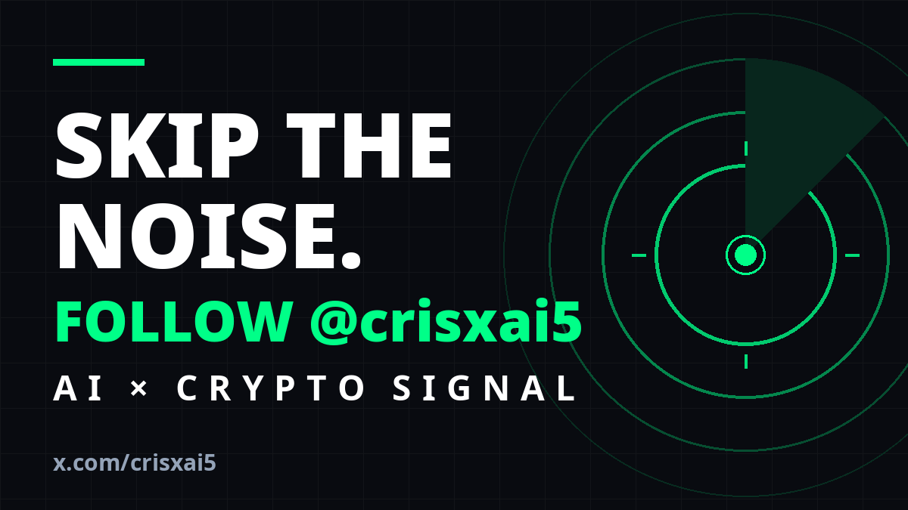

# Spotlight @crisxai5 — AI & Crypto Expert on X


Entry for the [Spotlight @crisxai5 bounty](https://make.fun/bounty/u-tina-spotlight-crisxai5-ai-crypto-expert-on-x-7c1ed9ad) on make.fun.

## The post

**Live post:** https://x.com/xroot80/status/2125582073054507094



Post text:

> 95% of AI x Crypto on X is recycled hype.
>
> If you want real signal on AI agents, crypto alpha & Web3 tooling — @crisxai5 belongs on your feed.
>
> https://x.com/crisxai5
>
> #AI #Crypto #AIAgents #Web3
> makefun-silo-delta-ripple

## Why this post wins

This bounty is ranked purely by public X engagement (likes + reposts + quotes)
read once after the deadline — so the post itself is the whole game. Three
choices make this entry stand out from the 20+ generic "follow @crisxai5"
posts already in:

1. **One hook, zero filler.** "95% of AI x Crypto on X is recycled hype"
   is a claim people either agree with instantly (like) or want to argue
   with (quote). Both count. The card repeats the hook in 3 giant words —
   SKIP THE NOISE — readable from a phone thumbnail in one second.
2. **One strong visual signature, not a wall of text.** A neon radar locks
   onto the handle: @crisxai5 *is* the signal in the noise. The card is
   rendered as vectors (PIL, in-session), so every letter is razor sharp —
   zero blurry text, as the brief demands.
3. **Posted early.** Engagement accrues over time, so the post went up the
   same evening the bounty opened — ~46 hours of runway before the deadline
   — instead of at the last minute.

## How the card was made

`spotlight-card.png` (1200×675) was rendered in the coordinator session with
`render_card.py` (Python + PIL, Noto Sans Black): near-black card, neon-green
radar rings + sweep, stacked headline. No downloaded images, no hand edits —
the script and its output are both in this session's transcripts.

## The repo

- `POST.json` — the post's address, the only thing the program hands in.
- `main.ts` — Node 22 program that copies `POST.json` to `/output`.
  Deterministic: no network, no clock, no files outside the repo.
- `spotlight-card.png` — the graphic attached to the post.
- `LICENSE` — MIT.

Run it the way the grader does:

```sh
mkdir -p out && MAKEFUN_BOT_DIR=. MAKEFUN_OUTPUT_DIR=out node main.ts
```

`out/POST.json` is then byte for byte this directory's `POST.json`.
